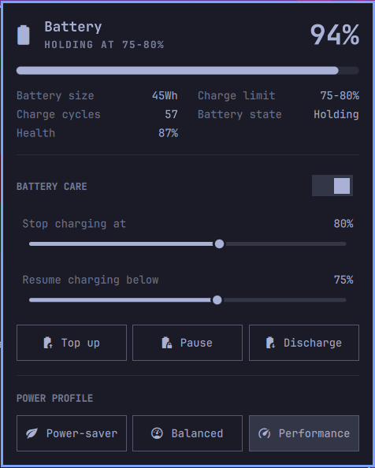

# Bettery Life for Omarchy



Omarchy's power widget with battery care, in the spirit of AlDente on macOS.
It replaces the built-in `omarchy.power` widget in place and keeps everything
it does (battery stats, power profiles, percentage toggle, `Super+Ctrl+P`),
adding a **Battery care** section:

- **Charge limit**: stop charging at a set level (50–100 %).
- **Sailing**: resume charging only below a lower level, so the battery is
  not topped up over and over while plugged in (e.g. 75–80 %).
- **Top up**: charge to 100 % once; the limit comes back when you unplug.
- **Pause**: stop charging where the battery is now.
- **Discharge**: run from the battery while plugged in, down to the limit.
- **Health**: today's capacity against the design capacity.

The limits live in the battery firmware, so they hold while the laptop
sleeps or is switched off, and no app has to keep running for them.

## Requirements

A kernel driver that exposes `charge_control_end_threshold` for your battery
(ThinkPads do, and many other recent laptops). Check with:

```sh
ls /sys/class/power_supply/*/charge_control_end_threshold
```

What the panel offers follows what the driver supports: the sailing
range needs `charge_control_start_threshold`, pause and discharge need
`charge_behaviour` with `inhibit-charge` and `force-discharge`. Without a
charge limit the widget behaves exactly like Omarchy's.

## Install

```sh
omarchy plugin add https://github.com/TimRudorf/omarchy-bettery.git --enable
sudo ~/.config/omarchy/plugins/io.github.timrudorf.bettery/install.sh
```

`install.sh` is a one-time setup and the only part that needs root. It adds

- a udev rule that lets members of the `wheel` group write the battery's
  `charge_control_start_threshold`, `charge_control_end_threshold`,
  `charge_behaviour` and `charge_types`, and nothing else, and
- a suspend hook that ends a forced discharge before the system sleeps, so the
  battery never drains unattended.

The [Uninstall](#uninstall) section undoes it.
`omarchy plugin disable io.github.timrudorf.bettery` puts the built-in power widget back.

## Uninstall

```sh
~/.config/omarchy/plugins/io.github.timrudorf.bettery/bin/bettery off
sudo ~/.config/omarchy/plugins/io.github.timrudorf.bettery/install.sh --remove
omarchy plugin remove io.github.timrudorf.bettery
rm -f ~/.config/omarchy/bettery.json
```

Removing the plugin restores Omarchy's power widget. The driver keeps the
last charge limit it was given, so run `bettery off` before uninstalling if
the battery should charge to 100 % again.

## Command line

```sh
~/.config/omarchy/plugins/io.github.timrudorf.bettery/bin/bettery status
bettery on | off | toggle
bettery limit 75 80      # resume below 75 %, stop at 80 %
bettery top-up | pause | discharge | resume
```

Each command is an IPC call to the running shell (`omarchy-shell bettery
<method>`), so it also works from Hyprland bindings or scripts.

Settings are kept in `~/.config/omarchy/bettery.json`.

## How it works

- `Service.qml` owns the policy: it applies the configured limit when the
  shell starts, follows the mode (top up, pause, discharge) and ends it when
  its condition is met (unplugged, limit reached).
- `bin/bettery-hw` is the only code that touches sysfs. It validates every
  value and writes the two thresholds in an order the driver accepts.
- `Panel.qml` and `Model.js` are Omarchy's power widget, extended for
  the Battery care section. The manifest declares
  `"omarchy": { "clonedFrom": "omarchy.power" }`, which makes the shell route
  `omarchy.power` calls to this plugin.

UPower has its own charge-limit switch (`EnableChargeThreshold`), but it only
turns fixed values from the hwdb on and off. Omarchy's battery status reads
UPower's values, so the plugin shows its own instead.

## Development

```sh
node --test tests/bettery.test.js
tests/bettery-hw.test.sh
omarchy plugin validate .
```

Saving a file under `~/.config/omarchy/plugins/` reloads the plugin. A plugin
checked out elsewhere and linked there is not watched; run
`omarchy restart shell` after changes.

## License

MIT. `Panel.qml` and `Model.js` started as copies of Omarchy's power widget
(MIT, David Heinemeier Hansson).
